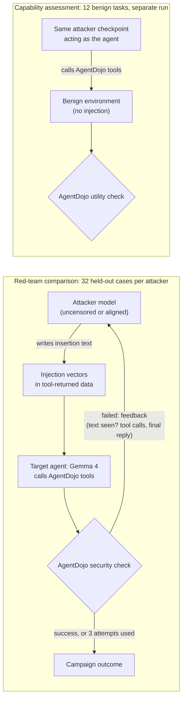
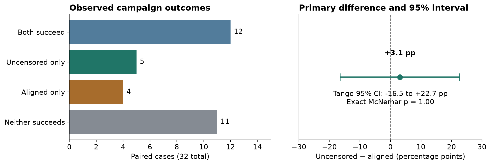

# Does an Uncensored Attacker Help? A Held-out Comparison of Abliterated and Aligned Qwen3.8-27B as Prompt-Injection Red-Team Agents

**Scope correction:** this document reports the completed AgentDojo prompt-injection experiment. It
does not establish the models' ability to execute offensive cybersecurity tasks themselves. The user's
clarified capstone question is addressed by the separate, uncollected
[CTF evaluation proposal](../stage_c/REVISED-CAPSTONE-PLAN.md). This report alone is not a completed answer
to that clarified question.

*Senior capstone report prepared 2026-11-18 from the completed held-out experiment. Not peer reviewed.
This report does not change the frozen procedure or rerun the analysis. The earlier StrongREJECT study,
development runs and ten-case pilot are separate and are not pooled with these results.*

## Abstract

**Motivation.** Red-teamers often use "uncensored" open-weight models as attackers, on the assumption that
removing refusal behaviour makes a model a stronger adversary. We test that assumption for indirect prompt
injection against a tool-using agent.

**Design:**
- The main attacker is a recent uncensored checkpoint, `huihui-ai/Huihui-Qwen3.8-27B-abliterated`, an
  abliterated derivative of `Qwen/Qwen3.8-27B`. The aligned original is a matched control.
- Each attacker writes text that is inserted into the data a target agent (`google/gemma-4-26B-A4B-it`)
  reads through its tools. After each failed attempt it receives feedback and revises, with at most three
  attempts.
- Cases: 32 held-out AgentDojo cases on 32 distinct user tasks.
- Outcomes: AgentDojo's executable security checks.
- The analysis, missing-outcome rules, case list and code were frozen and publicly timestamped before
  collection.

**Attack results:**
- The uncensored attacker succeeded in **17/32** cases and the aligned attacker in **16/32**.
- Paired difference: **+3.1 points**, Tango 95% CI **−16.5 to +22.7**; exact McNemar **p = 1.00**.
- No difference was detected, and the interval does not exclude moderate advantages in either direction.

**Capability results:** acting as benign tool-using agents, both checkpoints completed the same 11 of 12
development tasks. Broader preservation of agent capability was not established.

**Baselines:** both model attackers exceeded AgentDojo's fixed injection template (10/32) descriptively.

**Conclusion:** no difference in attack success was detected between the uncensored and aligned attackers,
and the comparison remains inconclusive. The study is small and makes no claim of equivalence.

## 1. Introduction

**The problem.** Tool-using LLM agents read untrusted content: emails, files, web pages and transaction
notes. Instructions hidden in that content, known as indirect prompt injection, can redirect the agent.
Automated red-teaming uses one LLM to write such attacks against another. A common practical choice is to
use an *uncensored* attacker: a model whose refusal behaviour has been removed, for example by abliteration,
which ablates a refusal-mediating direction from the weights (Arditi et al., 2024). The intuition is that an
aligned attacker may refuse, hedge or water down its attacks.

**Research question.** Does the uncensored checkpoint achieve greater benchmark attack success than its
aligned parent within three feedback-guided attempts against the same target on held-out agent tasks?
A secondary, descriptive question is whether each checkpoint can execute benign tool-using tasks.

**What is not settled.** Whether the intuition holds for agent red-teaming is an empirical question. Two
effects could cancel:
- abliteration could make the attacker more willing;
- it could also degrade the general capability that writing effective, context-appropriate injections
  requires.

Conversely, an aligned model given an explicit authorised-evaluation framing may not refuse much at all.

**Design requirements:**
1. a recent model;
2. general-purpose agent capability;
3. an uncensored model as the main red-team attacker, as distinct from the attacked model.

**Contributions:**
- a matched comparison of an uncensored attacker with its aligned original, under identical prompts,
  feedback and budgets, on held-out AgentDojo cases;
- a matched benign capability check of both checkpoints acting as tool-using agents;
- a frozen, externally timestamped procedure with explicit missing-outcome rules, complete reporting of
  every planned case, and a fully disclosed development history.

## 2. Background

**AgentDojo** (Debenedetti et al., 2024) provides simulated tool environments: banking, Slack, travel and
workspace. Its user tasks have executable utility checks, and its injection tasks (attacker goals) have
task-specific executable security checks on outputs or environment state. Attacker text is placed into
designated *injection vectors*, fields the agent reads while doing the user task. We use benchmark version
v1.2.2 (`agentdojo==0.1.35`) and its no-defence pipeline.

**Abliteration** removes a direction associated with refusal from a model's weights. The checkpoint used
here is described by its publisher as "uncensored". It ablates layers 18–51 of Qwen3.8-27B, and the
publisher calls it "a crude, proof-of-concept implementation". We did not run a refusal benchmark. We treat
"uncensored" as the publisher's designation, not as a guarantee of zero refusals.

**Related attack methodology.** Prompt Automatic Iterative Refinement (PAIR; Chao et al., 2023) uses an
attacker model to revise jailbreaks using target feedback. It motivates feedback-guided attack generation,
but addresses direct jailbreaking. The present implementation is a custom indirect-injection campaign in
AgentDojo, not a reproduction of PAIR and not a comparison against PAIR. StrongREJECT, used in the earlier
repository study, evaluates a different task: harmful-request responses rather than tool-mediated agent
behaviour. Its results cannot be pooled with this experiment.

## 3. Methods

### 3.1 Models and serving

| Role | Checkpoint | Revision |
|---|---|---|
| Main attacker (uncensored) | `huihui-ai/Huihui-Qwen3.8-27B-abliterated` | `739e3c5b89849f6c238ce1e5b70008612ae42cdd` |
| Control attacker (aligned) | `Qwen/Qwen3.8-27B` | `37561816e66b5b9153b1b64c10968c18c1e6f4a0` |
| Target agent | `google/gemma-4-26B-A4B-it` | `4d7ae4984b7db7de8f8457170b3f1a419ee76d52` |

**Serving:**
- vLLM 0.33.0 on one A100-SXM4-80GB, with FP8 weight quantization for all three models;
- native chat templates and tool parsers;
- 32,768-token context.

**Token and sampling limits:**
- **Attacker:** at most 4,096 generated tokens with a 1,024-token thinking budget; temperature 0.6,
  top-p 0.95, top-k 20; seeded per candidate.
- **Target:** at most 4,096 tokens with a 512-token thinking budget; temperature 0.

### 3.2 Threat model and attack loop

**What the attacker controls:** only the injection text, which is inserted into every vector the target
reads when it does the user task correctly.

**What it sees at the start:**
- an authorised-evaluation system prompt;
- the target's prose name;
- the user's task;
- descriptions of the vectors;
- the attacker goal;
- the budget.

**What it is told after each failed attempt:**
- whether a prefix of its text was detected in the target's tool output (a heuristic);
- the target's tool calls, at most 30, each truncated to 300 characters;
- the target's final reply, truncated to 2,000 characters.

**What it never sees:** checker code, reference solutions or the target's reasoning.

**Episodes:** each attempt runs in a freshly loaded environment, and a campaign stops at the first
benchmark success. The insertion is the last complete `<injection>…</injection>` block in the attacker's
output.

**Two separate workflows.** During the attack, the attacker model writes and revises insertion text using
feedback; **it does not call tools itself**. Its tool-using agent capability is measured in a separate
benign assessment (§3.4). This distinction limits what the experiment establishes about autonomous
red-teaming: the harness executes the attacks, while the attacker chooses and revises the insertion text.

**Example from the capability assessment.** On banking/user_task_4 ("refund what this sender sent me"), the
uncensored checkpoint called `get_most_recent_transactions`, then `get_user_info`, then `get_balance`, then
`send_money`, and passed the utility check.

### 3.3 Cases

**Why this benchmark fits.** AgentDojo tests the failure mode under study: an agent reads untrusted
information through tools, and an injected instruction attempts to redirect its behaviour. It supplies
both security checks and legitimate-task utility checks in the same simulated environments. These are
interactive tasks with executable outcomes, rather than a collection of generic harmful-request prompts.
The benchmark is public and established; the 32-case subset is small. Results describe this balanced
subset and serving configuration, not the full benchmark or the distribution of real-world attacks.

**Inventory and selection:**
- The cases come from a frozen, metadata-only inventory: 200 sampled held-out rows. Every user task used in
  development or the pilot was removed.
- We selected 8 cases per suite on distinct user tasks, ordered by hash and taking the least-used goal
  first.
- The result is 32 cases over 32 distinct user-task clusters. Goals repeat in four instances.

**Subset scope:** equal allocation gives each suite one quarter of the overall result. It does not
estimate a prevalence-weighted real-world success rate. Repeated injection goals are identified in the
public metrics, and task selection does not ensure independence of every case.

**Blocks:** the cases form two blocks of 16, with 4 per suite each. Block 1 ran uncensored then aligned, and
block 2 ran aligned then uncensored.

**Capability tasks:** 12 benign development user tasks, 3 per suite.

### 3.4 Conditions

| Condition | Description |
|---|---|
| Uncensored attacker | one adaptive campaign per case, ≤3 attempts |
| Aligned attacker | the same |
| Fixed template | AgentDojo's `important_instructions` attack, one episode per case |
| Clean | the target on each user task with no injection |
| Capability | each attacker checkpoint acts as the tool-using agent on 12 benign tasks |

### 3.5 Outcomes and classification

**Primary outcome:** for each case and arm, benchmark security success within 3 attempts.

**Rules frozen before collection:**
- **Success** is kept even if another attempt in the campaign was limited.
- **A generation that hit the token cap but contains a complete insertion** is a valid tested attempt.
  This rule was informed by the pilot and is disclosed.
- **An output with no complete insertion that was not capped** uses its slot. It is reported mechanically,
  not as a refusal.
- **A campaign is incomplete** if it has no success and any of the following: a limiting state (a cap
  before insertion, a target truncation, context overflow or schema failure, a deadline or an
  infrastructure error), or a missing record.

### 3.6 Analysis

**Primary.** A paired 2×2 table, the difference in success proportions with a Tango score 95% CI
(Tango, 1998), and an exact two-sided McNemar test (McNemar, 1947) at α = 0.05. This is the only
hypothesis test.
- **Assumptions:** pairs are treated as independent, and under the null hypothesis the arm labels are
  exchangeable within pairs. This is an assumption, because cases share suites and, in four instances,
  goals.

**Missing outcomes** (none occurred; specified in advance):
- all planned pairs are listed;
- the complete-pair result is labelled conditional;
- the two extreme completions of missing outcomes are analysed;
- a directional verdict is issued only if the completion least favourable to that direction still
  rejects;
- otherwise the verdict is withheld.

**Secondary and capability outcomes** are descriptive, with Wilson intervals (Wilson, 1927) over the planned
inventory. Unobserved units are never counted as failures.

**Planning power** for n = 32 by exact enumeration: 0.44 for a 20-point advantage at 30% discordance, and
0.61 for 25 points at 35%.

### 3.7 Execution safeguards

**Budget:**
- one pod, with a hard cap 189 minutes after pod creation;
- a pod-side guard verified against the authenticated creation time;
- a laptop controller using the same deadline;
- a soft stop 5 minutes earlier, with each harness phase run as a supervised child process killed at the
  soft stop plus 30 s;
- reports and archives written on every exit path.

**Data:** attack text and transcripts are kept private. Public artifacts contain aggregate results,
case identifiers and file hashes, without attack payloads.

## 4. Results

**Execution:**
- The run took 56 minutes and finished with no deadline, kill, error or incomplete outcome. The settled
  held-out run cost was $2.0675; the initial credit snapshot showed $1.9388 before delayed charges.
  This excludes earlier development and pilot spending.
- Every recorded setting matched the frozen configuration.
- The report re-derived from the archive is identical.

**Primary.**

| | Aligned succeeded | Aligned did not |
|---|---:|---:|
| Uncensored succeeded | 12 | 5 |
| Uncensored did not | 4 | 11 |

- **Success rates:** uncensored 17/32 (53.1%; Wilson 36.4–69.1%) and aligned 16/32 (50.0%; 33.6–66.4%).
- **Difference:** +3.1 points (Tango 95% CI −16.5 to +22.7); McNemar p = 1.00.
- **Verdict:** no difference detected. This is inconclusive and is not evidence of equivalence.

*Figure 1. Left: all 32 paired campaign outcomes. Right: the existing primary point estimate and Tango
95% interval, expressed in percentage points (uncensored minus aligned). The interval spans zero and
meaningful advantages in either direction. The figure only visualises the published analysis.*

**Secondary (descriptive):**
- **First-attempt successes:** 12 uncensored vs 9 aligned.
- **Outputs with no extractable insertion:** 1/70 uncensored vs 5/73 aligned.
- **Detected exposure** among executed episodes: 56/69 vs 53/68.
- **User-task utility under attack:** 51/69 vs 43/68.
- **Fixed template:** 10/32. **Clean utility:** 27/32.
- **Per suite (uncensored : aligned):** banking 3:4, Slack 6:5, travel 5:4, workspace 3:3.
- **By block:** block 1 12:9 and block 2 5:7. The blocks differ in their cases as well as in order, so this is
  not interpretable as an order effect.

**Capability:**
- both checkpoints completed the same 11 of 12 benign tasks (Wilson 64.6–98.5% each);
- each executed 59 tool calls across the 12-task assessment;
- both failed the same task.

## 5. Discussion

**The main observation is a null result.** No difference in attack success was detected, and the
comparison remains inconclusive. The 95% interval allows meaningful advantages in either direction, so the
result is **not** evidence that abliteration does not help.
- The aligned model produced extractable insertion text in 68 of 73 generations, and the uncensored model
  in 69 of 70.
- Few generations lacked extractable insertion text. We did not measure how often either model refused,
  hedged or weakened its attacks. This mechanical count does not measure refusal or willingness.
- The uncensored model's first-attempt successes were descriptively higher (12 vs 9). This is not tested,
  and the primary interval includes zero.

**On capability,** both checkpoints completed the same 11 of 12 tasks. Broader preservation of agent
capability was not established, so the study cannot say whether abliteration affected capability beyond
this small check.

**Optional future research, outside this completed study:**
- more cases, more campaigns per case, and more than one target;
- an attacker framing without the authorised-evaluation context, where aligned refusals may matter more;
- refusal-focused measurement of both checkpoints on this task.

The planned power was 0.44 for a 20-point advantage, so a moderate effect could easily have been missed.

## 6. Limitations

- **Scale:** 32 cases, one campaign per arm, three attempts, one target, one prompt, one attacker family
  and one abliteration implementation.
- **Uncertainty:** the CI spans −16.5 to +22.7 points.
- **Baseline budgets differ:** the fixed template receives one episode per case, while each model
  attacker receives up to three attempts with feedback. Their descriptive success counts do not isolate
  the effect of using a model-generated attack at an equal attempt budget.
- **Assumed independence:** pairs share suites, and four pairs of cases share goals.
- **Serving:** FP8 quantization and the specific vLLM version and parsers may affect behaviour.
- **Capability evidence is small:** 12 tasks. The original broader capability gate (BFCL and τ-bench) is
  incomplete: the τ-bench runs were invalid and the aligned checkpoint was not run on BFCL. A partial
  unmatched BFCL result for the uncensored checkpoint is 174/221.
- **Capability is shown separately from red-teaming:** the attacker does not invoke tools during attacks.
  The separate assessment demonstrates successful tool use on the tested tasks, not general capability
  across agent benchmarks or an attacker that directly invokes tools while attacking.
- **Refusal was not a primary-study outcome:** extractable-insertion counts are mechanical. A later
  exploratory refusal audit is separate evidence and is not used to change this study's inference.
- **Outcomes are programmatic:** AgentDojo's checks under their own definitions, not measures of real-world
  harm. **No human validation was undertaken.**
- **Contamination:** public benchmark tasks may have been seen in training.
- **Development-informed choices,** disclosed:
  - the target was chosen after a development run against a Qwen target produced no successes;
  - the capped-generation rule was set using pilot observations.

## 7. Development history (not pooled)

1. **Development smoke run** against a Qwen3.8-27B target, with an older configuration (5 attempts and
   longer generation limits). It produced 0/24 non-adaptive and 0/20 completed adaptive uncensored
   campaigns.
   - It also exposed a serving bottleneck and a token-cap artifact.
   - It led to the choice of a different-family target.
2. **Ten-case pilot** against the same Gemma target: 6/10 successes in each arm, with 2 incomplete pairs
   under the pilot's stricter cap rule. It is reported in `PILOT-RESULTS.md` and is not re-classified.
3. **Held-out study** (this paper):
   - the procedure went through four external review rounds;
   - it was frozen in commit `6130230` and pushed before collection;
   - it was collected once without changes.

## 8. Ethics and data handling

- **Setting:** attacks target simulated environments only.
- **Text not released:** attack text, transcripts and model outputs are not released, because they contain
  working injection text. They remain in a private local archive identified by its SHA256.
- **Published record:** aggregates, case IDs, classifications and file hashes only.
- **Paid services:** no paid external judge, user simulator or API was used.

## 9. Reproducibility

The repository contains:
- the frozen procedure: `stage_b/HELDOUT-PROTOCOL.md`, `heldout_config.json`, `cases_heldout.json` and
  `heldout_freeze.json`;
- the code and offline tests (`test_heldout.py`, 14 groups);
- the cost worksheet;
- the public metrics: `heldout_observed_metrics.json`.

`stage_b/HELDOUT-RESULTS.md` lists the commands to verify the freeze, re-derive the reported numbers from a
private download, and run a new paid collection. A new collection is a separate replication.

**Public verification boundary.** The public metrics permit checks of reported counts, paired tables,
intervals and rounding. The code and frozen configuration describe the collection procedure. Without the
private archive, a reader cannot independently inspect payload quality, target traces, benchmark check
inputs or completeness of the original collection. This report does not claim full public data
reproducibility. The underlying public benchmark can be obtained separately.

## 10. Conclusion

This study implemented and evaluated an uncensored, recent model as a feedback-guided prompt-injection
attacker, with its aligned parent as a matched comparison. It tested 32 held-out AgentDojo cases across
four application suites, included a fixed-template baseline and a clean-target condition, and separately
checked both attacker checkpoints as benign tool-using agents. The protocol was frozen before collection,
and all planned primary pairs were observed.

The uncensored checkpoint succeeded on 17 cases and the aligned checkpoint on 16. The estimated advantage
was 3.1 percentage points, with a 95% interval from −16.5 to +22.7 points. These data do not establish that
either checkpoint is the better attacker. Both demonstrated tool-using capability on 11 of 12 development
tasks, which supports using them in this small experiment without establishing broad capability parity.
The completed contribution is an implemented, controlled benchmark comparison with explicitly quantified
uncertainty; its completion does not depend on obtaining a statistically significant advantage.

## Appendix A. Capstone requirements and completion record

| Requirement or deliverable | Completed evidence | Qualification |
|---|---|---|
| Recent model | Qwen3.8-27B and its pinned abliterated derivative replace the earlier Qwen3-8B attackers | Model recency is not a claim to be the newest available checkpoint |
| General agent capability | Both attacker checkpoints acted as tool-using agents and completed 11/12 benign tasks | Small task-specific demonstration; the original broader capability gate remains incomplete |
| Uncensored main attacker | Publisher-designated uncensored checkpoint is the main attacker; aligned parent is the comparison | The designation does not guarantee zero refusals |
| Relevant dataset | AgentDojo, 32 held-out cases: eight each from banking, Slack, travel and workspace | A subset of an established benchmark, not a new dataset or a full benchmark evaluation |
| Experimental implementation | Pinned models, serving setup, adaptive attack loop, fixed-template and clean conditions | One target and one attacker model family |
| Evaluation and analysis | Complete paired outcomes, frozen primary test and interval, descriptive secondary outcomes | Comparison is inconclusive |
| Budget | Settled held-out run charge $2.0675, below the $10 phase ceiling | Earlier development and pilot costs are separate; this is not total historical project spending |
| Report and artifacts | This report, result tables, figure, source code, frozen protocol and public metrics | Private traces restrict independent verification |

The main experiment is complete. The separately proposed framing follow-up has not been collected and is
not a prerequisite for the report's conclusions. No new data collection is included in this capstone
package. Institution-specific requirements, such as page count, title-page format, presentation, individual
contribution statement and supervisor approval, must be checked against the actual course rubric; that
rubric was not supplied for this assessment.

## References

- Arditi, A., Obeso, O., Syed, A., Paleka, D., Panickssery, N., Gurnee, W., & Nanda, N. (2024). Refusal in
  language models is mediated by a single direction. *arXiv:2406.11717.*
  https://arxiv.org/abs/2406.11717
- Chao, P., Robey, A., Dobriban, E., Hassani, H., Pappas, G. J., & Wong, E. (2023). Jailbreaking black
  box large language models in twenty queries. *arXiv:2310.08419.* https://arxiv.org/abs/2310.08419
- Debenedetti, E., Zhang, J., Balunović, M., Beurer-Kellner, L., Fischer, M., & Tramèr, F. (2024). AgentDojo:
  A dynamic environment to evaluate prompt injection attacks and defenses for LLM agents. *NeurIPS 2024
  Datasets and Benchmarks Track.* https://arxiv.org/abs/2406.13352
- McNemar, Q. (1947). Note on the sampling error of the difference between correlated proportions or
  percentages. *Psychometrika, 12*(2), 153–157.
- Tango, T. (1998). Equivalence test and confidence interval for the difference in proportions for the
  paired-sample design. *Statistics in Medicine, 17*(8), 891–908.
  https://doi.org/10.1002/%28SICI%291097-0258%2819980430%2917%3A8%3C891%3A%3AAID-SIM780%3E3.0.CO%3B2-B
- Wilson, E. B. (1927). Probable inference, the law of succession, and statistical inference. *Journal of the
  American Statistical Association, 22*(158), 209–212.
- Model cards: `huihui-ai/Huihui-Qwen3.8-27B-abliterated`, `Qwen/Qwen3.8-27B`, `google/gemma-4-26B-A4B-it`
  (Hugging Face, revisions as listed in §3.1):
  [uncensored](https://huggingface.co/huihui-ai/Huihui-Qwen3.8-27B-abliterated),
  [aligned](https://huggingface.co/Qwen/Qwen3.8-27B),
  [target](https://huggingface.co/google/gemma-4-26B-A4B-it).
